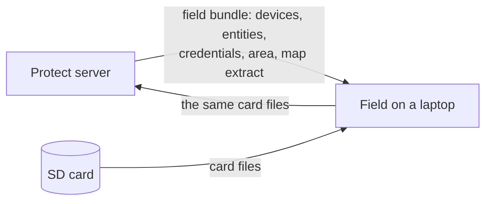

# Smart Parks Protect Field

The companion of [Smart Parks Protect](https://smartparksorg.github.io/smartparks-protect/) for the place without a connection. A RangerEdge offload station collects the flash logs trackers offload to it over LP0 and writes them to an SD card; Protect reads such a card on its server. Field reads the same card on a laptop in the field, with Protect's own decoding code, so the people who collected the card see the positions and the measurements before they are back where there is a connection. When there is one, Field hands the untouched card files to Protect, which decodes them itself.

Status: phase 0, the repository and its tooling (2026-10-17). Follow `PROJECT_PLAN.md` in the repository for what is being built and in which order.

## Where to look

| Page | For whom | What it covers |
| --- | --- | --- |
| [The contract with Protect](contract.md) | Developers | What comes down in a field bundle, what goes up, and what never travels |
| [Decisions](adr/index.md) | Developers | Architecture decision records |
